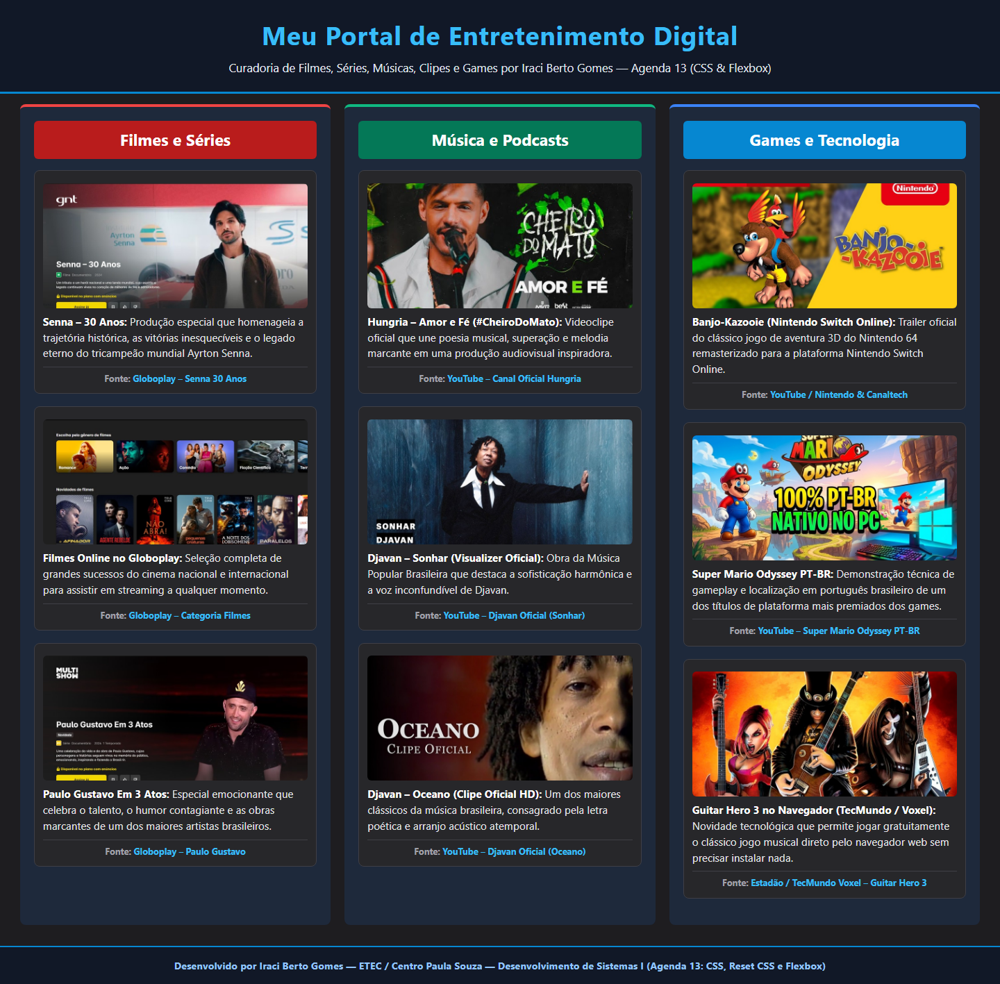

# 🎬🎵🎮 Meu Portal de Entretenimento Digital — Agenda 13 (CSS & Flexbox)

**Curso Técnico em Desenvolvimento de Sistemas — ETEC / Centro Paula Souza**  
**Componente Curricular:** Desenvolvimento de Sistemas I (Programação Web I — Agenda 13)  
**Estudante:** Iraci Berto Gomes  

---

## 🌐 Links de Acesso ao Portal Online (GitHub Pages)
- 🔗 **Página Principal (`index.html` / `portal.html`):** https://bertogomesiraci-33.github.io/AGENDA_13/
- 🔗 **Link direto para `portal.html`:** https://bertogomesiraci-33.github.io/AGENDA_13/portal.html

---

## 📋 Sobre o Projeto
Página web temática desenvolvida com **HTML5**, **CSS3** (Inline, Interno e Externo), **CSS Reset (Eric Meyer v2.0)** e layout responsivo em **3 colunas com Flexbox** (`display: flex; flex-direction: row; flex-grow: 1;`):

1. **🎬 Filmes e Séries (`#secao-filmes` / `.coluna1`):**
   - *Senna – 30 Anos* (Globoplay)
   - *Catálogo de Filmes Online no Globoplay*
   - *Paulo Gustavo Em 3 Atos* (Globoplay)
2. **🎵 Música e Podcasts (`#secao-musica` / `.coluna2`):**
   - *Hungria – Amor e Fé (#CheiroDoMato)*
   - *Djavan – Sonhar (Visualizer Oficial)*
   - *Djavan – Oceano (Clipe Oficial HD)*
3. **🎮 Games e Tecnologia (`#secao-games` / `.coluna3`):**
   - *Banjo-Kazooie Trailer (Nintendo 64 – Nintendo Switch Online)*
   - *Super Mario Odyssey PT-BR no PC*
   - *Guitar Hero 3 no Navegador (Estadão / TecMundo Voxel)*

---

## 🖼️ Visualização do Portal no Navegador

